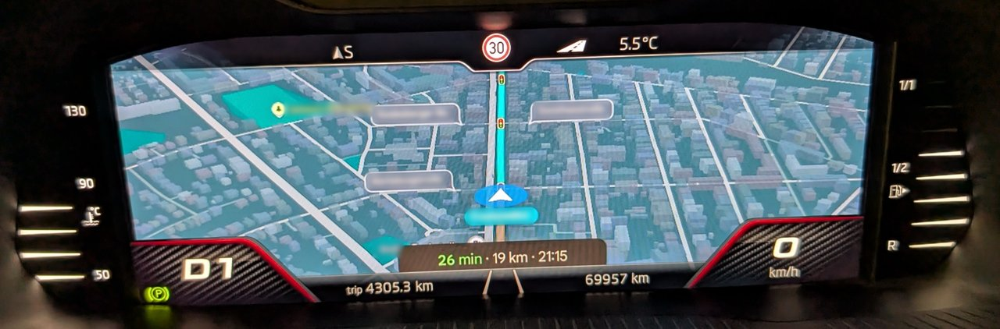
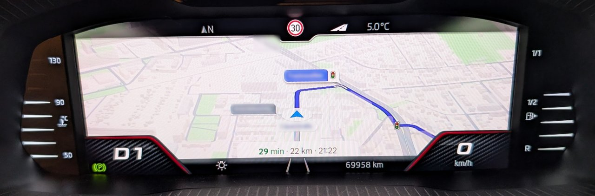

# MIB Cluster Map for Skoda

**Android Auto on the Skoda Virtual Cockpit:** the live Google Maps or Waze
map from your phone, sharp and without the green turn card in the way.





*The standard view on a Superb, at night and by day: no turn card, the car
just below the middle, the arrival time in a line at the bottom. Street names
blurred.*

For Skoda cars with the Harman **MIB2.5 High** head unit (firmware train
`MHI2_ER_SKG13_`) and the Virtual Cockpit. **Android Auto only**: no CarPlay.
Developed and car-tested on a **Skoda Superb**:

| | |
|---|---|
| Head unit software | MU1440 |
| Firmware train | `MHI2_ER_SKG13_P4526` |
| Cockpit map window | 1010×376 |

This is a Skoda fork of
[MacsInSpace/mib-cluster-map](https://github.com/MacsInSpace/mib-cluster-map),
which does the real work: the hook, the player and the installer come from
there (see [Credits](#credits)). This fork tunes the picture and the layout
for the Skoda cockpit.

> [!CAUTION]
> This modifies system files on the head unit. A mistake can leave the phone
> connection, or the whole centre screen, not starting. Use it only on a car
> you own, keep the SD card, keep the battery charged, and never install or
> test while driving. No warranty of any kind. Read
> [Safety and recovery](docs/Install.md#safety-and-recovery) first.

## Features

- **The phone's own map on the cockpit.** Google Maps or Waze, live, with and
  without a route. No app on the phone and no VNC: the phone sends a second
  video stream for the cluster, and the head unit shows it in the cockpit's map
  view like its own navigation.
- **Sharp 720p picture, 1:1.** The phone draws exactly the cockpit window's
  1010×376 pixels, and they are shown without any stretching or scaling.
- **Smooth.** Decoded with the Tegra 3's NEON unit: 17 to 30 pictures a
  second in the car (the phone sends at most 30).
- **In step with the centre screen.** The cockpit map runs 0.03 to 0.2
  seconds behind the phone (measured in the car), not about 2 seconds as
  up to 1.3.
- **True colours.** The picture is converted the way the phone sends it, with
  deep blacks and full contrast.
- **Turn card your way.** Hidden by default, so the map is free and the
  arrival time sits in a line at the bottom. Or shown **top right** or
  **top left**, chosen in the car; the choice survives updates.
- **Day and night** follow the car's light sensor, as on the centre screen.
- **Easy install:** an SD card and the car's own software update. No toolbox,
  laptop or command line. The installer checks the unit first and changes
  nothing that does not fit.
- **Green menu screen** for status, logs, the turn card, the map size and
  uninstall.
- **Settings kept** across updates: lines you change in `gal_dualscreen.conf`
  come back with the next package.

## Changelog

### 1.4.0 (compared with 1.3)

- **Cockpit map no longer about 2 seconds behind the centre screen.**
  Measured on the Superb: 34 to 213 ms on average per minute, at most
  308 ms, with no fewer pictures a second than before (17 to 30).
  The phone sends a cluster picture only while it has ACK credit, and the
  player ACKs a picture once it is drawn. The hook also returned the credit
  of pictures it took for dropped whenever more than four were outstanding,
  but since the 720p decoder became the slowest step those pictures were
  only waiting in the loopback socket, so the phone kept filling that queue
  (1.3.0 car log: 79 such credits in 3.5 minutes, about 13 real drops). Now
  the player ACKs every picture itself (drawn, replaced before it was drawn,
  or not decodable) and the hook no longer guesses; the phone may have 4
  pictures in flight instead of 8 (`GAL_SECONDARY_MAX_UNACKED`); and each
  picture is passed to the decoder as soon as it has arrived, not when the
  next one starts. The hook log's `ack.latency` line gives the delay once a
  minute, the player log's `acks:` line how the pictures were acknowledged.
- **Window correction works** (from upstream, #95): when the cockpit's map
  window is not the size the installer chose, the player's correction script
  could not find its own folder and never ran. It now corrects the settings
  and saves the size, which the next install uses when the display manager
  does not list the window. No change on the Superb, whose 1010×376 is set in
  `GAL_PLAYER_WINDOW`.

### 1.3.0 (compared with 1.2)

- **720p picture shown 1:1.** The phone sends 1280×720 with margins that
  leave exactly the cockpit window, instead of 800×480 stretched to 1010
  pixels across. Clearly sharper on the Superb. It replaces the "sharper map"
  of 1.1 and 1.2.
- **Correct colours.** The phone sends limited-range BT.709; the player took
  it as full range, so blacks were grey and the map pale. Now deeper blacks
  and more contrast.
- **About twice as smooth.** The player's H.264 decoder uses the Tegra 3's
  NEON unit: a 720p picture takes 28 to 53 ms to decode instead of about
  100 ms, so the cockpit shows 17 to 28 pictures a second instead of 9 to 10
  (measured in the car). The few NEON routines that access memory in a way
  the head unit's QNX kernel does not allow use FFmpeg's C code instead.
  Should the player still crash, it decodes without NEON until the next
  reboot by itself (`GAL_PLAYER_NEON=0` does the same on purpose).
- The decoder hands each picture over without copying it, and the drawing
  side copies it, so the decoder can start the next one sooner (about 10 %
  more pictures when the map moves a lot; not yet measured in the car).
- **Turn card setting:** hidden (standard), top right or top left, from the
  green menu or `CLUSTERMAP_TURN_CARD`; the next install keeps it.
- **Simpler green menu:** the sharper-map switch, the picture switch, the
  30 fps cockpit test and the turn card tests are gone.
- The player logs once a minute how many pictures it shows and how long each
  step takes.

### 1.2

- Based on upstream **v1.2.1**: the installer checks the unit's Android Auto
  program before it changes anything, reports missing tools first, and has
  several silent stops fixed; your `gal_dualscreen.conf` lines are kept across
  updates; the green menu works from either SD slot or a USB stick; the update
  starts by itself when the card goes in (`Swdlautorun.txt`).
- CarPlay removed: this fork is Android Auto only.

### 1.1.2

- Turn card hidden, sharper map (the whole frame with wide pixels), map size
  DPI 110, automatic day/night, cockpit window preset to 1010×376.

## Install

1. **Make the SD card.** Format a 2 to 32 GB card as FAT32. Download the zip
   from [Releases](../../releases) (or [build it](#building)) and copy
   everything inside it to the card:

   ```text
   (SD card)
   ├── ClusterMap/
   ├── Custom/
   ├── metainfo2.txt
   └── Swdlautorun.txt
   ```

   Put it in **SD slot 1**, with the other slot empty.
2. **Run the update.** Engine running or a charger connected. On most units
   the card starts the update by itself within a couple of minutes. If it
   does not, hold **MENU** until the service screen appears, then
   `Software updates/versions` > `Update` > the SD card >
   **`MIB Cluster Map`**. Let it finish (a "Version back documentation"
   screen at the end is normal: press `Cancel`), then hold the power button
   for ten seconds to reboot.
3. **Use it.** Plug in the phone, start a map, and switch the Virtual Cockpit
   to its map view with the steering wheel buttons.

The update writes what it did to `ClusterMap/update_result.txt` on the card.
On the Skoda it also adds the `NavActiveIgnore` patch, without which the
cockpit drops the map as soon as the phone starts a route; the green menu's
**Status** screen should then say `NavActiveIgnore: loaded`.

To update, run the update from the newer package the same way.

**Uninstall:** green menu > `ClusterMap` > **Uninstall and restore original
state**, then reboot. Or, without the menu: on a computer, move
`UNINSTALL.txt` from the folder `to uninstall, move this file up one folder`
up into `ClusterMap`, and run the same update again.

The SSH route, every setting, and recovery are in the
[Install guide](docs/Install.md).

## Green menu

The update adds a **ClusterMap** screen to the green engineering menu (hold
MENU > `Testmode` > `Green Developer Menu`). Each entry changes only the
unit's own copy of the settings and takes effect after a reboot.

| Entry | What it does |
|---|---|
| Status and compatibility check | What is installed and working |
| Install / Uninstall | The same as the software update |
| Turn card hidden (standard) | No green card; the arrival time at the bottom |
| Turn card top right | The card in the top right corner with the arrival time under it; the car lower down |
| Turn card top left | The same space moved right, so the card has room on the left (Maps decides the side) |
| Test: map smaller / larger, Map size as installed | DPI -10 / +10, or back |
| Save logs to SD | Logs for a bug report |

The turn card setting is kept by the next install; the other entries go back
to the card's settings when you install again.

## Status on the Superb (`P4526`)

| Part | State |
|---|---|
| Install by software update, green menu | Car-tested |
| Android Auto map, with and without a route; automatic day/night | Car-tested |
| 720p picture 1:1, colours | Car-tested: sharper |
| NEON decoder (smoothness) | Car-tested: 17 to 30 pictures a second instead of 9 to 10 |
| Cockpit delay behind the phone (1.4.0) | Car-tested: 0.03 to 0.2 s on average instead of about 2 s |
| Picture handover without a copy in the decoder (1.3.0) | Car-tested: runs fine; its own gain not measured separately |
| Turn card hidden, top right | Car-tested |
| Turn card top left, keeping the choice across installs | Not yet car-tested |
| Map size switch | Not yet car-tested |
| Turn arrow and music on the cockpit beside the map (`CLUSTERMAP_TURN_INFO`) | Not offered on `P4526`: the arrows jar is not known to work here |
| Zooming the cockpit map from the steering wheel, switching between the phone's map and the car's map | Not possible so far ([why](docs/Development.md#zoom)) |

## Will it work on my car?

| Car | Today |
|---|---|
| Skoda Superb, `MHI2_ER_SKG13_P4526` | **Yes**, tested with this fork |
| Other Skoda with the Harman unit, `MHI2_ER_SKG13_` | Not tested. Run the update: the installer checks the real firmware, installs only what fits, and otherwise collects the files needed to add the unit (see [Getting your unit added](docs/Install.md#getting-your-unit-added)) |
| SEAT `MHI2_ER_SEG11_P4708` and `P4709` | The same 1010×376 window, so these settings may suit it; not tested with this fork |
| VW, Audi | Use [upstream](https://github.com/MacsInSpace/mib-cluster-map/releases): the settings here are tuned for the Skoda |
| CarPlay | Not in this fork |

You need the Virtual Cockpit for the map. The firmware train is on the green
menu **Status** screen. A unit whose train does not start with `MHI2_ER_`
(MIB2 Standard, for example, starts with `MST2_`) is a different unit and not
covered.

## Settings

Everything is in `ClusterMap/gal_dualscreen.conf` on the card, and nothing
needs editing. The ones this fork adds:

| Setting | Standard | |
|---|---|---|
| `CLUSTERMAP_720P` | 1 | 0 goes back to the 800×480 picture, only if the cockpit ever shows no map with 720p |
| `CLUSTERMAP_TURN_CARD` | hidden | `top_right` or `top_left` |
| `GAL_SECONDARY_DPI` | 110 | lower draws the map, its text and the card smaller |
| `GAL_PLAYER_COLOR` | auto | `old` for the colours before 1.3 |
| `GAL_PLAYER_NEON` | 1 | 0 decodes without NEON (slower) |
| `GAL_SECONDARY_MAX_UNACKED` | 4 | 3 for a little less delay; 8 as up to 1.3 |

All settings are in the [Install guide](docs/Install.md#settings).

## Building

From Git Bash on Windows with Docker Desktop, or on Linux and macOS:

```bash
RELEASE_VERSION=v1.4.0-skoda ./build_local.sh
```

The package lands in `dist/` and its contents in `dist/sdcard/`. The head unit
replaces the green menu only for a higher version number, which
`RELEASE_VERSION` gives: `X.Y.Z-betaN` counts as X·10000 + Y·1000 + Z·100 + N
and a release as N = 99 (`v1.4.0-beta2` is 14002, `v1.4.0` 14099),
whatever follows (`-skoda`). The first run builds FFmpeg with NEON once.
Details are in [Development](docs/Development.md) and at the top of
`build_local.sh`.

Releases are named `mib-cluster-map_v1.4.0-skoda.zip`, test versions
`mib-cluster-map_v1.4.0-betaN-skoda.zip`.

## Reporting a problem

Open an issue [here](https://github.com/AMDFX60/mib-cluster-map/issues), in
German or English. Say which car, firmware train and package, what you did and
what you saw. Attach the logs from green menu **Save logs to SD**, saved before
rebooting; a photo of the cockpit helps. Read the logs first: the system log
can contain phone names and Bluetooth addresses. Other cars:
[upstream](https://github.com/MacsInSpace/mib-cluster-map/issues).

## Credits

- **MacsInSpace** and the contributors of
  [mib-cluster-map](https://github.com/MacsInSpace/mib-cluster-map): the
  project this fork is based on, with its installer, green menu, firmware
  profiles and documentation.
- **chopinwong01**: [mhi2-android-auto-video-vc](https://github.com/chopinwong01/mhi2-android-auto-video-vc),
  the hook and player upstream is forked from.
- **andrewleech** and **OneB1t**: VcMOSTRenderMqb, the cluster rendering path
  the player derives from.
- **jilleb**, **olli991** and contributors: the MQB Coding MIB2 Toolbox. Its
  `NavActiveIgnore.jar` (contributed by andrewleech) and the signed header of
  its update metadata are bundled unmodified under `thirdparty/` (MIT).
- **adi961**: mib2-android-auto-vc, the turn-arrows jar, bundled under
  `thirdparty/` (MIT), built from
  [upstream's maintained fork](https://github.com/MacsInSpace/mib2-android-auto-vc).
- **kamgurgul**, **wasimlhr**, **aberbic** and the aa-proxy-rs project: 720p and
  1080p cluster streams from Android Auto, which led to the 720p picture;
  wasimlhr's QNX build of FFmpeg with NEON; kamgurgul's and luka-dev's notes
  behind the connection-loop fix, the player priority and the open QNX
  toolchain; aberbic's decoder layout for the hardware-decoding path.
- **kkrvch** ([mib-std2-kombibridge](https://github.com/kkrvch/mib-std2-kombibridge)):
  the Android Auto 1.7 navigation decoder ported into `src/nav_translate.c`,
  with the author's permission.
- **harman-f** (via [M.I.B.](https://github.com/Mr-MIBonk/M.I.B._More-Incredible-Bash)):
  the Audi build of `NavActiveIgnore.jar`, bundled unmodified under
  `thirdparty/navactiveignore-audi/` (GPL-2.0) for upstream's Audi support.
- **Mr-MIBonk** ([M.I.B.](https://github.com/Mr-MIBonk/M.I.B._More-Incredible-Bash)):
  the `Swdlautorun.txt` trigger for installing without the service menu.
- **lito69**, **tulio150** and **DaniFR3**: car tests and porting files for
  the SEAT and the settings.
- **FFmpeg**: H.264 decoding, statically linked, LGPL v2.1 or later.

## License

GPL-3.0, the same as upstream. See [LICENSE](LICENSE). Release packages
contain files built from this source plus the items above under their own
licences. They contain no Volkswagen, Skoda, Harman, Google or Apple program
files.

Not affiliated with or endorsed by Volkswagen AG, Skoda Auto, Harman, Google
or Apple. Android Auto and Google Maps are trademarks of Google LLC.
